# Entity Relationship Documentation (SYNTHETIC)

```mermaid
erDiagram
  countries ||--o{ legal_entities : "country_id"
  divisions ||--o{ business_units : "division_id"
  countries ||--o{ facilities : "country_id"
  legal_entities ||--o{ facilities : "legal_entity_id"
  business_units ||--o{ facilities : "business_unit_id"
  facilities ||--o{ plants : "facility_id"
  plants ||--o{ production_lines : "plant_id"
  legal_entities ||--o{ departments : "legal_entity_id"
  facilities ||--o{ cost_centres : "facility_id"
  profit_centres ||--o{ cost_centres : "profit_centre_id"
  business_units ||--o{ profit_centres : "business_unit_id"
  countries ||--o{ suppliers : "country_id"
  suppliers ||--o{ supplier_locations : "supplier_id"
  suppliers ||--o{ materials : "primary_supplier_id"
  suppliers ||--o{ materials : "secondary_supplier_id"
  divisions ||--o{ products : "division_id"
  products ||--o{ bom : "product_id"
  materials ||--o{ bom : "material_id"
  products ||--o{ routings : "product_id"
  production_lines ||--o{ routings : "production_line_id"
  facilities ||--o{ assets : "facility_id"
  production_lines ||--o{ assets : "production_line_id"
  facilities ||--o{ meters : "facility_id"
  facilities ||--o{ vehicles : "facility_id"
  countries ||--o{ customers : "country_id"
  facilities ||--o{ employees : "facility_id"
  departments ||--o{ employees : "department_id"
  suppliers ||--o{ supplier_contracts : "supplier_id"
  purchase_orders ||--o{ po_lines : "po_id"
  materials ||--o{ po_lines : "material_id"
  cost_centres ||--o{ po_lines : "cost_centre_id"
  suppliers ||--o{ purchase_orders : "supplier_id"
  facilities ||--o{ purchase_orders : "facility_id"
  supplier_contracts ||--o{ purchase_orders : "contract_id"
  po_lines ||--o{ goods_receipts : "po_line_id"
  facilities ||--o{ goods_receipts : "facility_id"
  materials ||--o{ goods_receipts : "material_id"
  suppliers ||--o{ ap_invoices : "supplier_id"
  purchase_orders ||--o{ ap_invoices : "po_id"
  facilities ||--o{ ap_invoices : "facility_id"
  ap_invoices ||--o{ ap_payments : "invoice_id"
  suppliers ||--o{ supplier_performance : "supplier_id"
  customers ||--o{ sales_orders : "customer_id"
  sales_orders ||--o{ so_lines : "sales_order_id"
  products ||--o{ so_lines : "product_id"
  facilities ||--o{ so_lines : "ship_from_facility_id"
  so_lines ||--o{ deliveries : "so_line_id"
  customers ||--o{ deliveries : "customer_id"
  deliveries ||--o{ ar_invoices : "delivery_id"
  customers ||--o{ ar_invoices : "customer_id"
  ar_invoices ||--o{ ar_receipts : "ar_invoice_id"
  deliveries ||--o{ customer_returns : "delivery_id"
  customers ||--o{ opportunities : "customer_id"
  products ||--o{ production_orders : "product_id"
  production_lines ||--o{ production_orders : "production_line_id"
  facilities ||--o{ production_orders : "facility_id"
  production_orders ||--o{ production_confirmations : "production_order_id"
  production_orders ||--o{ material_consumption : "production_order_id"
  materials ||--o{ material_consumption : "material_id"
  production_lines ||--o{ mes_line_daily : "production_line_id"
  facilities ||--o{ mes_line_daily : "facility_id"
  assets ||--o{ machine_hourly : "asset_id"
  assets ||--o{ maintenance : "asset_id"
  facilities ||--o{ maintenance : "facility_id"
  production_orders ||--o{ quality_inspections : "production_order_id"
  meters ||--o{ energy_daily : "meter_id"
  facilities ||--o{ energy_daily : "facility_id"
  facilities ||--o{ utility_invoices : "facility_id"
  meters ||--o{ utility_invoices : "meter_id"
  suppliers ||--o{ utility_invoices : "utility_supplier_id"
  facilities ||--o{ fuel_purchases : "facility_id"
  meters ||--o{ water_daily : "meter_id"
  facilities ||--o{ water_monthly : "facility_id"
  facilities ||--o{ waste_records : "facility_id"
  suppliers ||--o{ waste_records : "waste_contractor_id"
  waste_records ||--o{ waste_certificates : "waste_record_id"
  meters ||--o{ iot_telemetry : "meter_id"
  suppliers ||--o{ shipments : "carrier_id"
  shipments ||--o{ freight_invoices : "shipment_id"
  suppliers ||--o{ freight_invoices : "carrier_id"
  vehicles ||--o{ fleet_fuel : "vehicle_id"
  employees ||--o{ business_travel : "employee_synthetic_id"
  facilities ||--o{ business_travel : "origin_facility_id"
  facilities ||--o{ commuting_survey : "facility_id"
  facilities ||--o{ office_occupancy : "facility_id"
  facilities ||--o{ safety_monthly : "facility_id"
  chart_of_accounts ||--o{ gl_transactions : "gl_account"
  legal_entities ||--o{ gl_transactions : "legal_entity_id"
  cost_centres ||--o{ gl_transactions : "cost_centre_id"
  emission_factors ||--o{ ghg_activities : "emission_factor_id"
  facilities ||--o{ ghg_activities : "facility_id"
  facilities ||--o{ contractual_instruments : "allocated_facility_id"
  ghg_activities ||--o{ scope2_market : "ghg_activity_id"
  suppliers ||--o{ supplier_esg_assessments : "supplier_id"
  suppliers ||--o{ supplier_disclosures : "supplier_id"
  suppliers ||--o{ supplier_pcfs : "supplier_id"
  emission_factors ||--o{ supplier_pcfs : "emission_factor_id"
  suppliers ||--o{ supplier_certifications : "supplier_id"
  suppliers ||--o{ supplier_questionnaires : "supplier_id"
  customers ||--o{ customer_requirements : "customer_id"
  facilities ||--o{ air_pollutants : "facility_id"
  facilities ||--o{ environmental_incidents : "facility_id"
  facilities ||--o{ environmental_permits : "facility_id"
  facilities ||--o{ biodiversity : "facility_id"
  facilities ||--o{ social_kpis : "facility_id"
  facilities ||--o{ decarbonisation : "facility_id"
  credit_projects ||--o{ credit_transactions : "project_id"
  materials ||--o{ inventory_balances : "material_id"
  facilities ||--o{ inventory_balances : "facility_id"
  documents ||--o{ document_extractions : "document_id"
```

## Key business chains
- Supplier -> Contract -> Purchase Order -> PO Line -> Goods Receipt -> AP Invoice -> GL Transaction
- Facility -> Energy Meter -> Daily/IoT Reading -> Utility Invoice -> GL Transaction -> GHG Activity -> Emission Factor -> Inventory
- Customer -> Sales Order -> SO Line -> Delivery -> AR Invoice -> Shipment -> Scope 3 Cat 4/9 activity
- Asset -> Maintenance (refrigerant top-up) -> Scope 1 fugitive activity
- Waste Record -> Waste Invoice -> Waste Certificate -> Scope 3 Cat 5 activity
- Document -> Extraction -> Source Record -> GHG Activity -> Inventory -> Audit Event